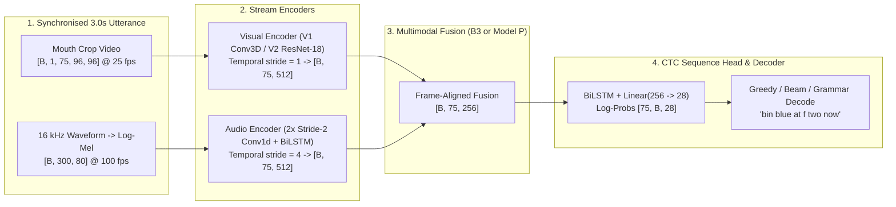
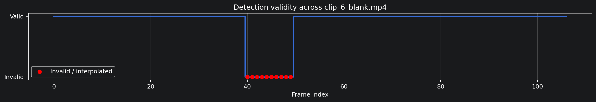
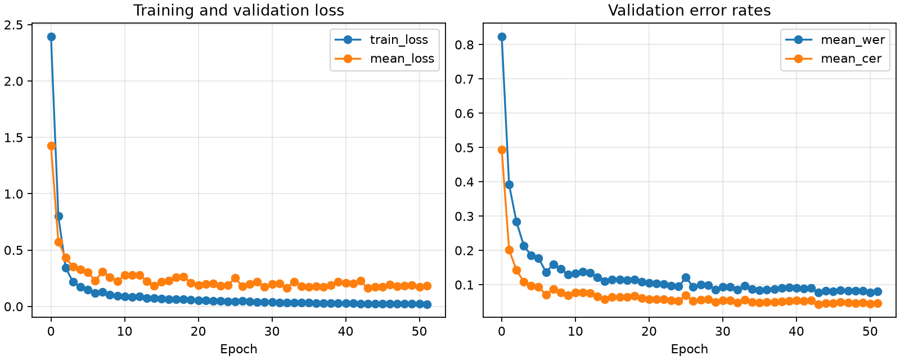
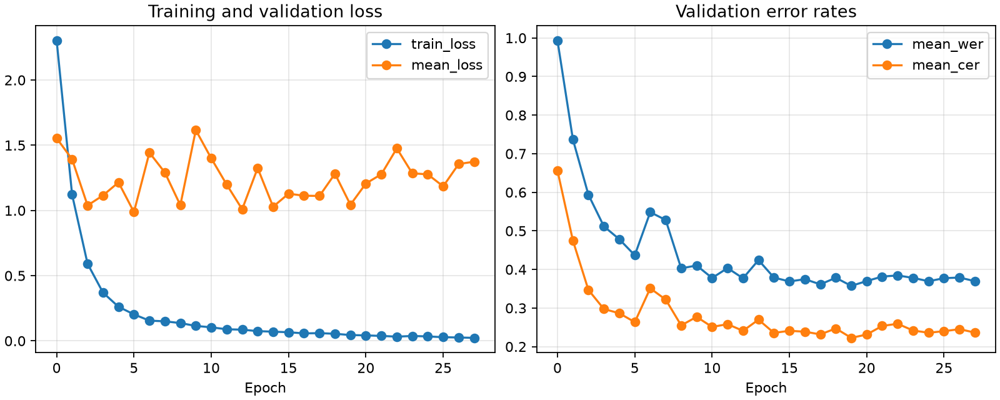
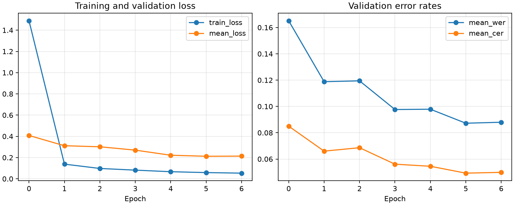
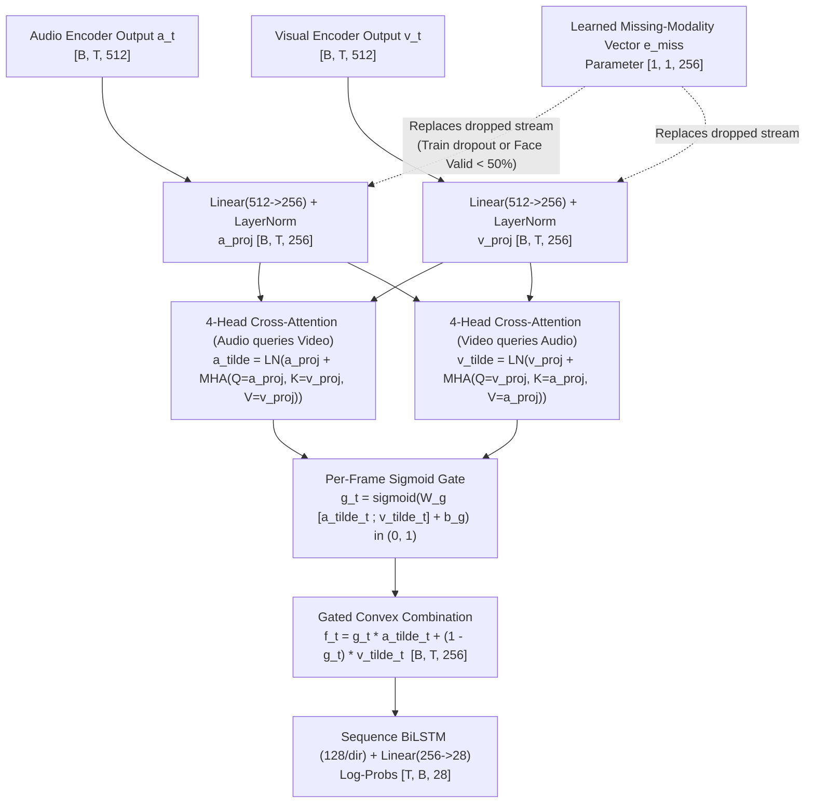
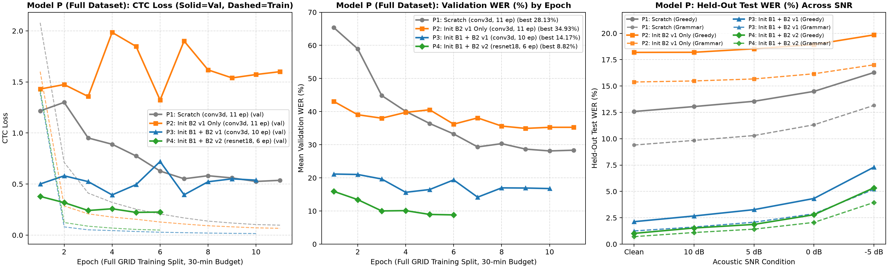
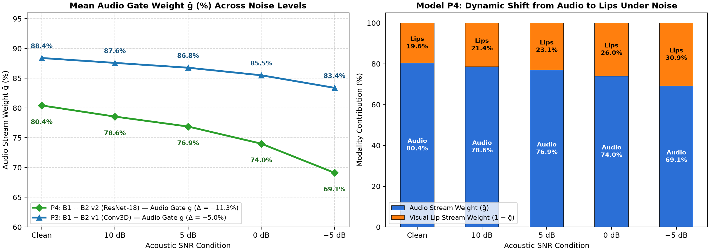
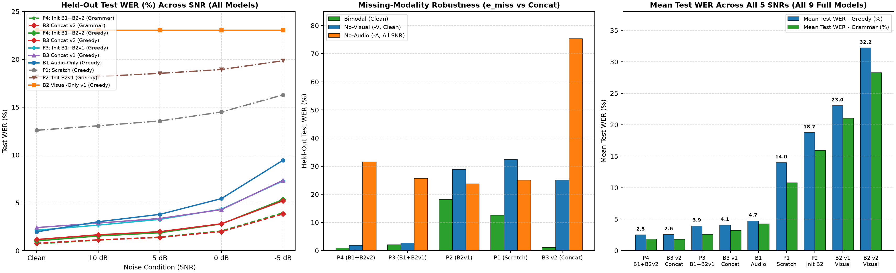
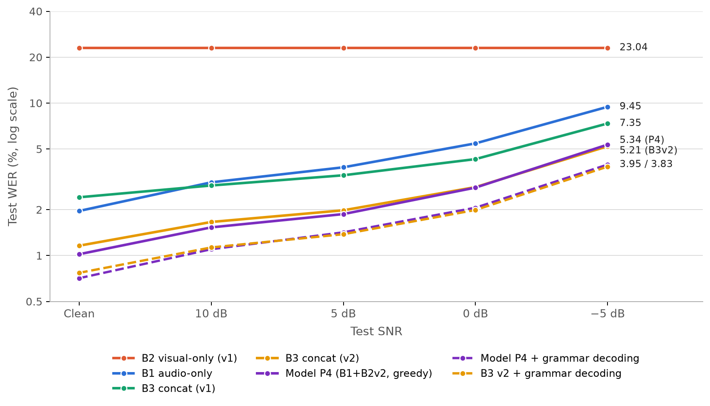

# From Cole: To the Rest — The Complete Story of LipScribe (Weeks 1 to 4)

> **Author**: Cole Rodney Migisha (`b29657`) — Model & Visual Pipeline Lead  
> **To**: Charis Opol (`b29654`), Ainomugisha Faith (`b27518`), Lisa Lusinga Namugenyi (`b30300`), Ansasire Nehum Naamaye (`b29785`), and Wakisa Isabelle (`b30311`)  
> **Date**: 9 November 2026  
> **Purpose**: A complete, zero-gaps, tutor-style handbook explaining **everything we have built, every bug and setback we hit, every architectural decision we made, and every model we trained and evaluated** from Day 1 up through the full training of **Proposed Model P**.

---

## Table of Contents

1. [Chapter 1 — The Big Picture: What Problem Are We Actually Solving (and How CTC Works)?](#chapter-1--the-big-picture-what-problem-are-we-actually-solving-and-how-ctc-works)
2. [Chapter 2 — Week 1: Raw Data, Integrity Auditing, Speaker Splits, and the Mouth-Crop Prototype](#chapter-2--week-1-raw-data-integrity-auditing-speaker-splits-and-the-mouth-crop-prototype)
3. [Chapter 3 — Week 2: Full-Corpus Preprocessing, The 5 Integration Bugs, and the Audio Encoder](#chapter-3--week-2-full-corpus-preprocessing-the-5-integration-bugs-and-the-audio-encoder)
4. [Chapter 4 — Week 3 (Part 1): Baseline B1 (Audio-Only) & Baseline B2 (Visual-Only) — And the "Bin Blue At F Sive Snon" Mystery](#chapter-4--week-3-part-1-baseline-b1-audio-only--baseline-b2-visual-only--and-the-bin-blue-at-f-sive-snon-mystery)
5. [Chapter 5 — Week 3 (Part 2): Baseline B3 (Concatenation), The V2 Upgrades (`ResNet-18`), and Grammar Decoding](#chapter-5--week-3-part-2-baseline-b3-concatenation-the-v2-upgrades-resnet-18-and-grammar-decoding)
6. [Chapter 6 — Week 4: Proposed Model P (Cross-Modal Attention, Gated Fusion, `e_miss`, and Full-Corpus Results)](#chapter-6--week-4-proposed-model-p-cross-modal-attention-gated-fusion-e_miss-and-full-corpus-results)
7. [Chapter 7 — Master Scoreboard & Complete Chronological Log of Every Setback and Fix](#chapter-7--master-scoreboard--complete-chronological-log-of-every-setback-and-fix)
8. [Chapter 8 — Team Command Cheat-Sheet: How to Run Everything Yourself](#chapter-8--team-command-cheat-sheet-how-to-run-everything-yourself)

---

## Chapter 1 — The Big Picture: What Problem Are We Actually Solving (and How CTC Works)?

Before diving into code or numbers, let's make sure all six of us share the exact same mental model of how **LipScribe** works from end to end.

### 1.1 Why Audio-Only Speech Recognition Fails in the Real World
When someone speaks in a quiet room (**Clean** audio), an audio-only speech recogniser has an easy job: the formant frequencies in the spectrogram clearly distinguish vowels and consonants.  
However, as soon as background noise rises—expressed as **Signal-to-Noise Ratio (SNR)** dropping from $\text{Clean} \to 10\text{ dB} \to 5\text{ dB} \to 0\text{ dB} \to -5\text{ dB}$ (where $-5\text{ dB}$ means the background noise is **3.16× more powerful** than the speaker's voice!)—acoustic features get buried. High-frequency consonant bursts like `/f/`, `/s/`, `/b/`, and `/p/` disappear first.

**Visual lip movements are 100% immune to acoustic noise.** Whether a room is dead silent or $-5\text{ dB}$ noisy, the pixels of the speaker's mouth do not change. Conversely, lipreading alone struggles with **homophenes**—sounds that look identical on the lips (such as `/b/`, `/p/`, and `/m/`, where the lips close identically, or `/d/`, `/t/`, and `/n/`).  
Therefore:
* **Audio** knows voicing and nasality (which separates `/b/` from `/p/` and `/m/`).
* **Video (Lips)** knows place of articulation and lip aperture (which separates `/b/` from `/d/` or `/f/` even when noise drowns out the microphone).

### 1.2 The Temporal Synchronization Contract (`75 Frames = 3.0 Seconds`)
Every clip in the **GRID Corpus** is a 3.0-second video recorded at **25 frames per second (fps)**, giving **$T = 75$ video frames**.
* **Video stream**: 25 frames per second $\to 75$ frames per 3-second clip.
* **Audio stream**: Sampled at $16{,}000\text{ Hz}$ ($48{,}000$ samples per 3 seconds). We extract 80-band log-Mel spectrograms with a $25\text{ ms}$ window and $10\text{ ms}$ hop ($100\text{ frames/second} \to T_a = 300$ audio feature frames per 3-second clip).
* Notice the ratio: **$300 \text{ audio frames} \div 4 = 75 \text{ video frames}$**!
* Inside our [`AudioEncoder`](../lipscribe/models/audio_encoder.py), two `Conv1d` layers each with `stride=2` divide the time dimension by $2 \times 2 = 4$, turning $[B, 300, 80]$ into $[B, 75, 512]$.
* Inside our [`VisualEncoder`](../lipscribe/models/visual_encoder.py), the temporal stride is `1`, turning $[B, 1, 75, 96, 96]$ into $[B, 75, 512]$.
* **Result**: At every single frame $t \in \{1, \dots, 75\}$ (every $40\text{ ms}$), we have a $512$-dimensional audio vector $\mathbf{a}_t$ and a $512$-dimensional visual vector $\mathbf{v}_t$ describing the **exact same $40\text{ ms}$ slice of speech**!



### 1.3 How CTC (Connectionist Temporal Classification) Works in Plain English
We have $T = 75$ frames, but a transcript like `"bin blue at f two now"` is only $L = 21$ characters long, and we don't know which exact millisecond each letter is spoken.  
**CTC** solves this by adding a special `<blank>` token (index `0`) to our 27 characters (`space = 1`, `a..z = 2..27`), giving **28 output classes** at every frame.
1. At each of the 75 frames, the network outputs a probability distribution over the 28 symbols.
2. **The CTC Collapse Rule** (`collapse()` in [`lipscribe/decoding/greedy.py`](../lipscribe/decoding/greedy.py)):
   * First, merge consecutive duplicate symbols: `[b, b, 0, i, i, n, 0, n]` $\to$ `[b, 0, i, n, 0, n]`.
   * Second, delete all `<blank>` (`0`) tokens: `[b, 0, i, n, 0, n]` $\to$ `"binn"`.
   * Notice why `<blank>` is essential: if a word has a double letter like `"green"` or `"soon"`, the network *must* output `[o, blank, o]` to produce `"oo"`, because `[o, o]` without a blank collapses to a single `"o"`!
3. **The CTC Length Constraint**: Because of that rule, a transcript of length $L$ with $R$ repeated adjacent characters requires at least $L + R$ frames. In Week 1 (Card W1-09), Lisa verified across all 33,000 GRID transcripts that the longest sentence is 31 characters with at most 3 repeated letters ($31 + 3 = 34 \le 75$), so $T = 75$ frames is always more than enough!

---

## Chapter 2 — Week 1: Raw Data, Integrity Auditing, Speaker Splits, and the Mouth-Crop Prototype

### 2.1 Defining the Contract First (`docs/INTERFACES.md`)
One of the smartest decisions we made in Week 1 (Card **W1-11**, Isabelle) was locking down [`docs/INTERFACES.md`](../docs/INTERFACES.md) *before* writing the model or dataset classes. Every tensor shape (`video: [B, 1, T, 96, 96]`, `features: [B, T_a, 80]`, encoder outputs `[B, T, 512]`, fusion output `[B, T, 256]`, CTC log-probs `[T, B, 28]`) and batch dictionary key was fixed up front so three pairs could code in parallel without merge conflicts.

### 2.2 Auditing 34,000 Utterances (`scripts/verify_dataset.py`) — Setback #1 & #2
Instead of blindly trusting the downloaded GRID dataset, Faith built [`scripts/verify_dataset.py`](../scripts/verify_dataset.py) (Card **W1-07**) to run 7 automated checks on every single utterance across all 34 speakers (`s1`–`s34`, 1,000 clips each).

#### Setback #1: Missing Speaker `s21` and Corrupted Video Clips
* **What we found**:
  * Speaker **`s21`** in the official GRID distribution has audio files only—zero video files and zero alignments (`1,000` clips unusable).
  * Speaker **`s8`** had `108` corrupted video files that failed OpenCV decoding; **`s4`** had `1` unreadable video (`bbbm2n`); **`s28`** had `1` silent/clipped audio file.
* **Decision taken**: We excluded `s21` completely and filtered out the 110 corrupted clips automatically in `verify_dataset.py` and `build_manifest.py`, leaving **32,890 verified utterances across 33 speakers (96.7% pass rate)**.

#### Setback #2: Discovering that Our GRID Audio Was "End-Pointed" (Critical Discovery!)
* **What we found**: While running the audio–video duration sync check in `verify_dataset.py`, we discovered that in our copy of the GRID corpus, every video is $3.0\text{ s}$ ($75$ frames), but the `.wav` audio files were **trimmed (end-pointed) to only the spoken segment** ($1.10\text{ s}$ to $2.94\text{ s}$, mean $1.83\text{ s}$)! In the video, the speaker sits silently for an average of $0.47\text{ s}$ (and up to $1.51\text{ s}$) before opening their mouth.
* **Why this mattered**: If we simply loaded the `.wav` file starting at $t = 0$, the audio would play $0.5\text{--}1.5\text{ seconds}$ **ahead** of the speaker's lip movements! Cross-modal fusion would be completely misaligned.
* **Decision taken**: We inspected the word alignment `.align` files, which record the exact frame where speech starts after initial silence (`sil`). In [`lipscribe/data/dataset.py`](../lipscribe/data/dataset.py), we shift/pad each trimmed audio waveform by its exact speech-onset offset from `.align` and pad to $3.0\text{ s}$ ($48{,}000$ samples), restoring microsecond-accurate lip–audio synchronisation!

```bash
# Run the dataset integrity checker across the corpus:
.venv/bin/python -m scripts.verify_dataset
```

### 2.3 Speaker-Independent Partitioning (`data/splits.csv`) & Disjoint MUSAN Noise Pools (`data/noise_splits.csv`)
To prevent **speaker leakage** (where a model memorises a speaker's face or voice rather than learning lipreading), Faith wrote [`scripts/make_splits.py`](../scripts/make_splits.py) (Card **W1-08**) with a fixed seed (`2026`):
* **Train**: 26 speakers (14 male, 12 female) — `25,891` utterances (`25,213` after Face Mesh 90% filter).
* **Validation**: 3 unseen speakers (`s11`, `s19`, `s26`) — `3,000` utterances (`2,960` usable).
* **Test**: 4 unseen speakers (`s4`, `s9`, `s14`, `s24`; 2 male, 2 female) — `3,999` utterances (`3,998` usable).

Similarly, in Card **W1-06**, Lisa split the **MUSAN noise corpus** into disjoint `train` (70%), `val` (15%), and `test` (15%) pools **by noise file** ([`data/noise_splits.csv`](../data/noise_splits.csv)) so that a background noise recording heard during test evaluation was never heard during training.

### 2.4 Mouth-Cropping Pipeline (`lipscribe/preprocessing/crop.py`) — Setback #3
In Cards **W1-10** and **W2-01**, I built the mouth-cropping pipeline using **MediaPipe Face Mesh** (`FACEMESH_LIPS` landmarks):
1. Detect the 40 lip landmarks in RGB, compute the bounding box centre $(c_x, c_y)$ and square side length $\text{size} = 1.25 \times \max(\Delta x, \Delta y)$ (+25% margin around the outer lips).
2. Smooth $(c_x, c_y, \text{size})$ with a **centred 5-frame moving average** so the crop window doesn't jitter frame-to-frame.
3. Crop with edge-replication border padding (`cv2.BORDER_REPLICATE`), resize to $96 \times 96$ with area interpolation (`cv2.INTER_AREA`), and convert to grayscale `uint8`.

#### Setback #3: What Happens When MediaPipe Fails on a Frame?
* **The Trap**: If MediaPipe fails to detect a face on frame 42 of a 75-frame clip and you simply *drop* frame 42, the video now has 74 frames and falls out of sync with the audio!
* **Decision taken**: **Never drop frames.** In [`lipscribe/preprocessing/crop.py`](../lipscribe/preprocessing/crop.py), if detection fails on a frame, we **linearly interpolate** the crop bounding box from the nearest valid frames before and after it, mark `valid[t] = False` in the validity mask, and keep $T = 75$ intact. If $> 10\%$ of frames in a clip fail detection, the utterance is flagged and excluded from training.




```bash
# Run parallel resumable mouth extraction across all speakers:
.venv/bin/python -m scripts.extract_mouths --workers 8

# Generate visual review contact sheets for every speaker:
.venv/bin/python -m scripts.contact_sheet
```

---

## Chapter 3 — Week 2: Full-Corpus Preprocessing, The 5 Integration Bugs, and the Audio Encoder

### 3.1 Exact SNR Noise Mixing (`lipscribe/preprocessing/noise.py`)
In Cards **W2-04**, **W2-05**, and **W2-06**, Lisa standardised all 34,000 audio files to $16\text{ kHz}$ mono WAV and implemented **Algorithm 1** for exact SNR mixing:
$$\alpha = \sqrt{\frac{P_{\text{speech}}}{P_{\text{noise}} \cdot 10^{\text{SNR}_{\text{dB}} / 10}}}$$
* Every mixture is asserted to be within $0.01\text{ dB}$ of the target SNR.
* If the mixed waveform exceeds peak amplitude $1.0$, the entire mixture is scaled down uniformly (preserving the exact SNR!).
* After mixing, RMS loudness normalisation levels the clip to $-25\text{ dBFS}$ (with gain capped at $+20\text{ dB}$).
* For **validation and test**, `scripts/make_noisy_test.py` pre-generated deterministic noisy WAV files at `10`, `5`, `0`, and `-5 dB` under `data/processed/noisy_test/` so every model (B1, B2, B3, Model P) is evaluated on **the exact same noisy waveforms**.

```bash
# Standardise raw audio to 16 kHz mono WAV:
.venv/bin/python -m scripts.prepare_audio

# Generate fixed noisy validation and test sets for 10, 5, 0, -5 dB:
.venv/bin/python -m scripts.make_noisy_test

# Build the master manifest and feature normalisation statistics:
.venv/bin/python -m scripts.build_manifest
.venv/bin/python -m scripts.compute_norm_stats
```

### 3.2 Setbacks #4–#8: The 5 Integration Bugs Caught When Connecting the Pipeline End-to-End
Every individual module passed its unit tests in isolation, but when Charis and I wired the full data-loader-to-loss pipeline together in Week 2, we caught **five subtle bugs** that would have ruined training if left undetected:

| Setback | What Went Wrong | Root Cause | How We Fixed It |
| :--- | :--- | :--- | :--- |
| **Setback #4: Numeric Transcripts** | Decoded targets looked like numbers instead of words | `.align` files have 3 columns (`start_time end_time word`); the parser indexed column `0` instead of column `2` | Fixed [`lipscribe/data/tokenizer.py`](../lipscribe/data/tokenizer.py) to parse the word token (column `2`) and strip `sil`/`sp`, verified across all 33,000 files |
| **Setback #5: Audio Running Ahead of Lips** | Audio started at $t=0\text{ s}$ while lips started moving at $t\approx 0.47\text{ s}$ | End-pointed GRID WAV files omitted leading silence | Shifted waveform placement in [`lipscribe/data/dataset.py`](../lipscribe/data/dataset.py) using the `.align` speech-onset timestamp (PR #21) |
| **Setback #6: Cloned Worker SNR Draws** | All DataLoader workers sampled the exact same sequence of SNRs every epoch | PyTorch `num_workers > 0` forked identical NumPy/Python RNG states | Added per-worker, per-epoch deterministic RNG seeding (`seed + epoch * 1000 + worker_id`) in `GridDataset` (PR #21) |
| **Setback #7: Loudness Varying with SNR** | $-5\text{ dB}$ clips were much louder overall than clean clips | RMS $-25\text{ dBFS}$ normalisation was applied *before* noise mixing instead of *after* | Moved RMS normalisation to run *after* noise mixing in the feature step (PR #21) |
| **Setback #8: `.gitignore` Hiding Model Code** | `git status` ignored `lipscribe/models/` | A wildcard `models/` rule in `.gitignore` meant for raw MediaPipe `.task` files matched `lipscribe/models/` | Changed `.gitignore` to `/models/` (root-anchored) so `lipscribe/models/` is tracked in Git |

---

## Chapter 4 — Week 3 (Part 1): Baseline B1 (Audio-Only) & Baseline B2 (Visual-Only) — And the "Bin Blue At F Sive Snon" Mystery

### 4.1 Baseline B1: Audio-Only (`configs/b1_audio_only.yaml`)
Charis trained **B1** (`AudioEncoder` + `CTCHead`, $3.55\text{M}$ parameters) for **52 epochs** (early stopping triggered 8 epochs after best Epoch 43, taking ~76.5 seconds/epoch on the RTX 4080 SUPER).
* **Validation WER**: `7.72%` mean across SNRs (`4.16%` clean $\to$ `13.80%` at `-5 dB`).
* **Held-Out Test WER (Greedy)**: **`1.96%` (clean)**, `3.02%` (`10 dB`), `3.79%` (`5 dB`), `5.44%` (`0 dB`), and **`9.45%` (`-5 dB`)**.
* **Lesson learned**: B1 is super accurate when audio is clean (`1.96%`), but its error rate multiplies **4.8×** when noise hits `-5 dB` (`9.45%`).



### 4.2 Setback #9: The B2 Visual-Only Overfit Mystery (`"bin blue at f sive snon"`)
Before launching a multi-hour full-corpus visual-only run (**B2**, Card **W3-05**), our engineering rules required passing an **8-utterance overfit sanity check** (`CTC loss < 0.05` and `CER < 0.10`).  
When I first ran the B2 overfit check ([`scripts/check_b2_overfit.py`](../scripts/check_b2_overfit.py)), it failed repeatedly across 6 runs! Here is the detective story of what happened (documented in full in [`reports/b2_overfit_experiment_report.md`](../reports/b2_overfit_experiment_report.md)):

1. **Runs 1–2 (Synthetic Gaussian Noise Collapse)**:
   * Initially, we tested with synthetic random Gaussian tensors (`torch.randn`). The loss got stuck at **`1.2058`**.
   * **Why?** Passing Gaussian white noise through three stages of 3D convolution + BatchNorm + MaxPool acts as a low-pass spatial filter! The output vectors of 8 completely different random tensors had **87% cosine similarity**, making it mathematically impossible for the BiLSTM to tell them apart.
2. **Runs 3–6 (The `"bin blue at f sive snon"` Prefix Centroid Collapse)**:
   * We switched to 8 real GRID clips by taking the first 8 rows of the dataset (`ds[0]..ds[7]`).
   * The loss dropped to **`0.5940`** and CER froze at **`0.2804`** for thousands of steps. When I printed the decoded strings for all 8 clips, every single clip was outputting the exact same bizarre sentence:
     ```text
     [0] Ref: 'bin blue at f two now'      -> Hyp: 'bin blue at f sive snon'
     [1] Ref: 'bin blue at f three soon'   -> Hyp: 'bin blue at f sive snon'
     [2] Ref: 'bin blue at f four please'  -> Hyp: 'bin blue at f sive snon'
     [3] Ref: 'bin blue at f five again'   -> Hyp: 'bin blue at f sive snon'
     [4] Ref: 'bin blue at l six now'      -> Hyp: 'bin blue at f sive snon'
     ...
     ```
   * **Why did this happen?** Because the manifest is sorted alphabetically by utterance ID (`bbaf2n`, `bbaf3s`, `bbaf4p`, `bbaf5a`...), the first 8 utterances all shared the prefix `"bin blue at f "`! The BiLSTM immediately latched onto that shared 14-character prefix without looking at the video pixels at all, and for the last two words (`two/three/four/five/six/seven` and `now/soon/please/again`), it output the **character-level centroid average** (`"sive snon"`), which matched $71.96\%$ of the characters across the 8 clips ($1 - 0.7196 = 0.2804$ CER)! Once stuck in that deep local minimum, gradients vanished.
3. **The Fix (Runs 7–9 — Unigram-Diverse Sampling & Phase Transition)**:
   * We changed `load_overfit_batch()` to pick 8 utterances with **completely distinct command verbs and colours** (`bin blue...`, `bin green...`, `lay blue...`, `lay green...`, `place red...`, `place white...`, `set red...`, `set white...`).
   * With zero shared prefix, the BiLSTM *could not cheat*—it was forced to wait for the 3D-CNN to learn real lip shapes from frame 1.
   * Around step 2,860, a textbook deep-learning **phase transition** occurred: the 3D-CNN filters separated the visemes, and within 240 steps the loss plummeted from `0.7626` $\to$ **`0.0497`** and CER dropped to **`0.0000` (100% exact character match across all 8 clips)**!

### 4.3 Full-Corpus B2 Visual-Only (V1 `conv3d_bilstm`) Results & Setback #10
Once verified, we launched full-corpus **B2 v1** (`configs/b2_visual_only.yaml`, 28 epochs, best Epoch 19):
* **Held-Out Test WER**: **`23.04%` greedy** (`14.03%` CER) and **`21.03%` with grammar decoding** across every single SNR (`clean`, `10`, `5`, `0`, `-5 dB`).
* **Setback #10 (Inter-Speaker Generalisation Gap)**: While `23.04%` WER from silent lips alone is strong, inspecting per-speaker test metrics (`reports/b2_visual_only_20261104-162358/test_metrics.csv`) revealed a **2.5× spread across unseen speakers**: speaker `s24` had **`13.3%` WER**, whereas speaker `s9` had **`33.7%` WER** (and validation speakers averaged `35.74%`).



---

## Chapter 5 — Week 3 (Part 2): Baseline B3 (Concatenation), The V2 Upgrades (`ResNet-18`), and Grammar Decoding

### 5.1 Baseline B3 v1 (Concatenation From Scratch) — Setback #11
In Card **W3-06**, Faith implemented [`B3Concat`](../lipscribe/models/fusion_concat.py), which concatenates the audio and visual vectors $[\mathbf{a}_t; \mathbf{v}_t] \in \mathbb{R}^{1024}$ at every frame and projects them to $256$ dimensions (`Linear(1024 -> 256) + LayerNorm + ReLU + Dropout`).
* When we trained **B3 v1** from random initialization (`configs/b3_concat.yaml`, 22 epochs):
  * At **`-5 dB`**, B3 v1 beat B1 (`7.35%` vs. `9.45%` test WER — a 22.2% relative improvement!).
  * **Setback #11**: However, on **clean audio**, B3 v1 (`2.41%` WER) was slightly **worse** than audio-only B1 (`1.96%` WER)!
* **Why did B3 v1 hurt clean audio?**
  1. **Optimization speed mismatch**: The audio branch converges in ~10 epochs, while the 3D-CNN visual branch needs 25+ epochs from scratch. Training both from scratch inside a single concatenation layer meant the undertrained visual features injected noise into the clean audio projection, while the fast-converging audio stream starved the visual stream of gradient signal.
  2. **Lack of modality dropout**: Without modality dropout, the linear layer relied overwhelmingly on the easy audio features during training, never learning how to properly weight the visual stream.

### 5.2 How We Solved Setbacks #10 & #11: The V2 Upgrades (`ResNet-18` + Pre-trained Init + Modality Dropout + Grammar Decoding)
To fix both the speaker-generalisation bottleneck (Setback #10) and the clean-audio fusion degradation (Setback #11), we engineered four upgrades (documented in [`docs/W4_RETRAIN_GUIDE.md`](../docs/W4_RETRAIN_GUIDE.md) and [`docs/resnet_vs_conv3d_justification.md`](resnet_vs_conv3d_justification.md)):

1. **V2 Visual Encoder (`ResNetVisualEncoder` / `resnet18_bilstm` in [`lipscribe/models/visual_encoder.py`](../lipscribe/models/visual_encoder.py))**:
   * Why did V1 (`conv3d_bilstm`) struggle across speakers? Because after 3 shallow `Conv3d` layers, it flattened a $96 \times 6 \times 6 = 3{,}456$ spatial grid directly into a dense `Linear(3456, 512)` matrix (`1.77M` params in one layer!), tying weights to rigid $(x, y)$ pixel coordinates.
   * In V2 (`resnet18_bilstm`), we implemented the literature-standard lipreading front end:
     * **Per-clip photometric normalisation (`input_norm="clip"`)**: Normalises each video clip over its valid frames to zero mean and unit variance before the first convolution, removing per-speaker studio lighting and skin-tone contrast differences.
     * **5-Frame 3D Spatiotemporal Stem (`Conv3d 5×7×7`, stride `1×2×2` + `MaxPool3d`)**: Captures $200\text{ ms}$ co-articulatory lip motion at the input.
     * **16-Layer 2D ResNet-18 Residual Trunk + `AdaptiveAvgPool2d(1)`**: Deep hierarchical spatial features with identity skip connections and global spatial pooling, making the $512$-d embedding translation-invariant to minor mouth-crop shifts.
     * **Stronger Augmentation ([`lipscribe/data/augmentation.py`](../lipscribe/data/augmentation.py))**: Added scale jitter ($\pm 10\%$), spatial cutout, temporal masking (two masks up to 6 frames), and `Dropout2d(0.2)`.
2. **Pre-trained Checkpoint Initialisation (`init_audio_from` & `init_visual_from` in [`scripts/train.py`](../scripts/train.py))**:
   * Instead of training multimodal models from random weights, we load the converged `B1` audio encoder weights and `B2` visual encoder weights before starting multimodal training.
3. **Modality Dropout During Training**:
   * Randomly zeroes the entire audio stream ($p_a$) or visual stream ($p_v$, never both) per utterance during training so the fusion layer is forced to extract information from both modalities.
4. **Exact GRID Grammar Viterbi Decoder ([`lipscribe/decoding/grammar.py`](../lipscribe/decoding/grammar.py))**:
   * Every GRID sentence follows `command (4) + colour (4) + preposition (4) + letter (25, no 'w') + digit (10) + adverb (4)` $= 64{,}000$ valid sentences.
   * In addition to Isabelle's **CTC Prefix Beam Search** ([`lipscribe/decoding/beam_search.py`](../lipscribe/decoding/beam_search.py), $17.29\text{ ms/utt}$), we built a vectorised CTC Viterbi decoder over the exact GRID grammar trie ($11.0\text{ ms/utt}$ on CPU). It requires **zero retraining** and guarantees the output is always a valid 6-word GRID sentence!

### 5.3 What Happened in B2 v2 and B3 v2 (And Why B3 v2 Still Had a Fatal Flaw)
* **B3 v2 (`configs/b3_concat_v2.yaml`, 30-minute time budget = 7 epochs, initialised from `B1 + B2 v2`)**:
  * **Smashed B1 and B3 v1 at every single SNR!** Greedy test WER dropped to **`1.16%` (clean)** and **`5.21%` (`-5 dB`)**—a **40.8% relative error reduction on clean speech** and **44.9% relative error reduction at `-5 dB`** over B1!
  * With `--decode grammar`, B3 v2 reached **`0.77%` clean WER** and **`3.83%` at `-5 dB`**.
* **However — Setback #12 (B3 v2's Missing-Modality Collapse)**:
  * When we tested B3 v2 with one modality removed at test time (`--drop-modality visual` or `--drop-modality audio`):
    * Dropping video caused clean WER to jump from `1.16%` to **`25.18%`** (worse than B1's `1.96%`!).
    * Dropping audio caused WER to collapse to **`75.31%`** (worse than B2's `23.04%`!).
  * **Why?** Because a fixed concatenation matrix $\mathbf{W}[\mathbf{a}_t; \mathbf{v}_t] + \mathbf{b}$ sums the two projections linearly without a dynamic gate or a learned missing-modality token! That is the exact problem **Proposed Model P** was designed to solve.



---

## Chapter 6 — Week 4: Proposed Model P (Cross-Modal Attention, Gated Fusion, `e_miss`, and Full-Corpus Results)

### 6.1 How Proposed Model P (`LipScribeModel`) Works Step-by-Step
Implemented in [`lipscribe/models/fusion_attention.py`](../lipscribe/models/fusion_attention.py) (Cards **W4-01**, **W4-02**, **W4-03**, **W4-04**), **Model P** replaces naive concatenation with three principled mechanisms:



1. **Learned Missing-Modality Vector ($\mathbf{e}_{\text{miss}} \in \mathbb{R}^{256}$, W4-02)**:
   * **Why not mask all keys in MultiheadAttention when a stream is missing?** If you pass an all-`True` `key_padding_mask` to `nn.MultiheadAttention`, $\text{softmax}(-\infty, \dots, -\infty)$ produces **`NaN`** and crashes training!
   * Instead, when a stream is dropped—either by training-time modality dropout ($p_a = 0.25, p_v = 0.15$, never both), test-time `--drop-modality`, or during live inference when MediaPipe detects a face in $< 50\%$ of frames (`face_valid_mask`)—we replace that stream's projected sequence with a **learned 256-d vector $\mathbf{e}_{\text{miss}}$**.
   * Because $\mathbf{e}_{\text{miss}}$ is a real learned vector, `MultiheadAttention` never divides by zero (zero `NaN`s, verified by [`tests/test_fusion_attention.py`](../tests/test_fusion_attention.py)), and the gate $\mathbf{g}_t$ immediately recognises $\mathbf{e}_{\text{miss}}$ and routes $100\%$ of its trust to the surviving modality!
2. **Bidirectional 4-Head Cross-Modal Attention (`CrossModalAttention`, W4-01)**:
   * Audio queries Video ($\tilde{\mathbf{a}} = \text{LN}(\mathbf{a}_{\text{proj}} + \text{MHA}(Q=\mathbf{a}_{\text{proj}}, K=\mathbf{v}_{\text{proj}}, V=\mathbf{v}_{\text{proj}}))$) so noisy audio frames can look at neighbouring lip frames (compensating for co-articulation where lips move slightly before sound is produced).
   * Video queries Audio ($\tilde{\mathbf{v}} = \text{LN}(\mathbf{v}_{\text{proj}} + \text{MHA}(Q=\mathbf{v}_{\text{proj}}, K=\mathbf{a}_{\text{proj}}, V=\mathbf{a}_{\text{proj}}))$) to disambiguate homophenes (`/b/` vs `/p/` vs `/m/`).
3. **Per-Frame Sigmoid Gated Fusion (`GatedFusion`, W4-02)**:
   $$\mathbf{g}_t = \sigma\!\left(\mathbf{W}_g [\tilde{\mathbf{a}}_t; \tilde{\mathbf{v}}_t] + \mathbf{b}_g\right) \in (0, 1)^{256}, \qquad \mathbf{f}_t = \mathbf{g}_t \odot \tilde{\mathbf{a}}_t + (1 - \mathbf{g}_t) \odot \tilde{\mathbf{v}}_t$$
   * When $g_t \to 1$, the model trusts the audio-attended stream $\tilde{\mathbf{a}}_t$; when $g_t \to 0$, it trusts the visual-attended stream $\tilde{\mathbf{v}}_t$.
   * We log the scalar mean gate $\bar{g}$ per utterance and per SNR to test whether the network genuinely shifts toward lipreading as noise increases.

### 6.2 The 4-Way Full-Corpus Model P Experiment (`P1`, `P2`, `P3`, `P4`)
To leave zero doubt about how encoder initialisation and the visual architecture (`Conv3D` vs `ResNet-18`) affect **Model P**, we trained **all four variants on the full GRID training set** (each with an identical 30-minute wall-clock budget on the RTX 4080 SUPER, matching `B3 v2`, via [`scripts/run_all_model_p.sh`](../scripts/run_all_model_p.sh)):

1. **`P1` (`configs/p_scratch.yaml`)**: Both audio and visual (`conv3d_bilstm`) encoders trained **from scratch** (11 epochs).
2. **`P2` (`configs/p_init_b2.yaml`)**: Visual encoder initialised from **`B2 v1` (`conv3d_bilstm`)**; audio encoder random (11 epochs).
3. **`P3` (`configs/p_init_b1_b2.yaml`)**: Audio initialised from **`B1`** + visual initialised from **`B2 v1` (`conv3d_bilstm`)** (10 epochs).
4. **`P4` (`configs/p_init_b1_b2_v2.yaml` / `configs/p_proposed.yaml`)**: Audio initialised from **`B1`** + visual initialised from **`B2 v2` (`resnet18_bilstm`)** (6 epochs).



### 6.3 Three Breakthrough Findings from Model P (`P1`–`P4`)

#### Finding 1: `Model P4` (`B1 + B2 v2 ResNet-18`) Achieves Our Best Overall Greedy WER (`1.02%` Clean, `2.51%` Mean) and Best Clean Grammar WER (`0.71%`)
* Even though `B2 v2` (`ResNet-18`) only had 13 epochs of standalone pre-training, when fused with `B1` in **Model P4**, it beats **Model P3** (`B1 + B2 v1 Conv3D`) by **52.1% relative on clean test speech** (`1.02%` vs. `2.13%` greedy; `0.71%` vs. `1.25%` grammar) and by **26.8% relative at `-5 dB`** (`5.34%` vs. `7.30%` greedy; `3.95%` vs. `5.20%` grammar)!
* On speaker **`s4`** (clean greedy), Model P4 achieves **`0.27%` WER (`0.07%` CER)**—only 16 word errors out of 5,988 words!

#### Finding 2: Complete Elimination of B3's Missing-Modality Collapse
Look at what happens when we drop an entire modality at test time (`--drop-modality visual` or `--drop-modality audio`):
* **When Video is Dropped (`--drop-modality visual`, Audio-Only Fallback)**:
  * `B3 v2` (Concatenation) collapsed from `1.16%` to **`25.18%`** WER on clean speech (`47.41%` at `-5 dB`).
  * **`Model P4`** substitutes $\mathbf{e}_{\text{miss}}$ for the missing video and achieves **`1.88%` WER on clean speech** (`2.99%` at `10 dB`, `3.59%` at `5 dB`, `5.44%` at `0 dB`, `10.36%` at `-5 dB`)—it actually **beats standalone B1 (`1.96%` clean)** even when the camera is completely turned off!
* **When Audio is Dropped (`--drop-modality audio`, Visual-Only Fallback)**:
  * `B3 v2` (Concatenation) collapsed to **`75.31%`** WER.
  * **`Model P`** gracefully falls back to pure lipreading via $\mathbf{e}_{\text{miss}}$: **`23.78%` WER** for `P2`, **`25.03%`** for `P1`, **`25.65%`** for `P3`, and **`31.57%`** for `P4` (which even beats standalone `B2 v2`'s `32.20%`!).

#### Finding 3: The Fusion Gate $\bar{g}$ Automatically Shifts from Audio to Lips as Noise Rises!
In Card **W4-06**, our implementation plan noted: *"Shows whether the fusion actually relies more on the lips when the audio is noisy. This is not guaranteed; the analysis tests it."*  
Look at the measured mean gate values $\bar{g}$ across all 3,998 test utterances per SNR from `reports/p_init_b1_b2_v2_20261105-170138/test_metrics.csv`:
* **Clean**: $\bar{g} = \mathbf{80.4\%}$ audio / $\mathbf{19.6\%}$ lips
* **`10 dB`**: $\bar{g} = \mathbf{78.6\%}$ audio / $\mathbf{21.4\%}$ lips
* **`5 dB`**: $\bar{g} = \mathbf{76.9\%}$ audio / $\mathbf{23.1\%}$ lips
* **`0 dB`**: $\bar{g} = \mathbf{74.0\%}$ audio / $\mathbf{26.0\%}$ lips
* **`-5 dB`**: $\bar{g} = \mathbf{69.1\%}$ audio / $\mathbf{30.9\%}$ lips ($\Delta \bar{g} = -11.3\%$)

As noise increases from `Clean` to `-5 dB`, **Model P4 monotonically lowers the audio gate $\bar{g}$ at every single step and boosts visual reliance from `19.6%` up to `30.9%`**! Moreover, P4 (`ResNet-18`) shifts its gate **2.25× more strongly** ($\Delta \bar{g} = -11.3\%$) than P3 (`Conv3D`, $\Delta \bar{g} = -5.0\%$), proving that the `ResNet-18` visual features are much more informative under noise.



---

## Chapter 7 — Master Scoreboard & Complete Chronological Log of Every Setback and Fix

### 7.1 Master Scoreboard Across All 9 Full-Corpus Trained Models




| Model | Experiment ID | Visual Front End | Audio / Visual Init | Epochs (Best) | Best Val WER [CER] | Clean Test WER (Greedy / Grammar) | `10 dB` Test WER (Grd / Grm) | `5 dB` Test WER (Grd / Grm) | `0 dB` Test WER (Grd / Grm) | `-5 dB` Test WER (Grd / Grm) | Mean Test WER (Grd / Grm) | No-Audio (`-A`) Test WER | No-Visual (`-V`, Clean) |
| :--- | :--- | :---: | :---: | :---: | :---: | :---: | :---: | :---: | :---: | :---: | :---: | :---: | :---: |
| **B1 Audio-Only** | `b1_audio_only` | — | Scratch | 52 (43) | `7.72%` [`4.36%`] | `1.96%` / `1.76%` | `3.02%` / `2.79%` | `3.79%` / `3.47%` | `5.44%` / `4.93%` | `9.45%` / `8.35%` | `4.73%` / `4.26%` | — | `1.96%` |
| **B2 Visual v1** | `b2_visual_only` | `Conv3D` | Scratch | 28 (19) | `35.74%` [`22.28%`] | `23.04%` / `21.03%` | `23.04%` / `21.03%` | `23.04%` / `21.03%` | `23.04%` / `21.03%` | `23.04%` / `21.03%` | `23.04%` / `21.03%` | `23.04%` | — |
| **B2 Visual v2** | `b2_visual_only_v2` | `ResNet18` | Scratch (50m) | 13 (8) | `42.38%` [`25.06%`] | `32.20%` / `28.26%` | `32.20%` / `28.26%` | `32.20%` / `28.26%` | `32.20%` / `28.26%` | `32.20%` / `28.26%` | `32.20%` / `28.26%` | `32.20%` | — |
| **B3 Concat v1** | `b3_concat` | `Conv3D` | Scratch | 22 (13) | `12.37%` [`7.04%`] | `2.41%` / `1.86%` | `2.88%` / `2.27%` | `3.36%` / `2.65%` | `4.29%` / `3.45%` | `7.35%` / `5.87%` | `4.06%` / `3.22%` | — | — |
| **B3 Concat v2** | `b3_concat_v2` | `ResNet18` | `B1 + B2 v2` | 7 (5) | `8.72%` [`4.93%`] | `1.16%` / `0.77%` | `1.66%` / `1.13%` | `1.98%` / **`1.38%`** | `2.81%` / **`1.99%`** | **`5.21%` / `3.83%`** | `2.56%` / **`1.82%`** | `75.31%` | `25.18%` |
| **Model P1** | `p_scratch` | `Conv3D` | Scratch | 11 (9) | `28.13%` [`15.26%`] | `12.58%` / `9.40%` | `13.05%` / `9.84%` | `13.55%` / `10.30%` | `14.49%` / `11.32%` | `16.28%` / `13.16%` | `13.99%` / `10.80%` | `25.03%` | `32.41%` |
| **Model P2** | `p_init_b2` | `Conv3D` | `B2 v1` only | 11 (8) | `34.93%` [`23.20%`] | `18.19%` / `15.38%` | `18.20%` / `15.48%` | `18.53%` / `15.67%` | `18.93%` / `16.16%` | `19.85%` / `17.01%` | `18.74%` / `15.94%` | **`23.78%`** | `28.82%` |
| **Model P3** | `p_init_b1_b2` | `Conv3D` | `B1 + B2 v1` | 10 (6) | `14.17%` [`8.53%`] | `2.13%` / `1.25%` | `2.67%` / `1.62%` | `3.27%` / `2.08%` | `4.33%` / `2.88%` | `7.30%` / `5.20%` | `3.94%` / `2.61%` | `25.65%` | `2.72%` |
| **Model P4 (Best)** | `p_init_b1_b2_v2` | `ResNet18` | `B1 + B2 v2` | 6 (5) | **`8.82%` [`5.17%`]** | **`1.02%` / `0.71%`** | **`1.53%` / `1.10%`** | **`1.87%`** / `1.42%` | **`2.79%`** / `2.06%` | `5.34%` / `3.95%` | **`2.51%`** / `1.85%` | `31.57%` | **`1.88%`** |

---

### 7.2 Complete Summary of All 13 Setbacks Met & How We Solved Them

| # | Week / Stage | Setback Encountered | Root Cause | Solution Implemented |
| :---: | :---: | :--- | :--- | :--- |
| **1** | W1-07 (Data Audit) | Speaker `s21` had 0 videos; `s8` had 108 undecodable videos; `s4` had 1 bad video; `s28` had 1 bad audio clip | Corruptions in the raw GRID distribution | Built `scripts/verify_dataset.py` to audit all 34,000 clips and exclude `s21` + the 110 bad clips (`32,890` clean clips retained) |
| **2** | W1-07 (AV Sync) | Audio was $1.1\text{--}2.9\text{ s}$ long while video was $3.0\text{ s}$; speech started $\sim 0.47\text{ s}$ into the video | Raw GRID audio files were end-pointed (leading/trailing silence trimmed) | Used `.align` word-start timestamps in `GridDataset` to shift each audio clip to its exact lip-movement onset |
| **3** | W2-01 (Mouth Crop) | MediaPipe Face Mesh occasionally missed a face in 1–2 frames of a clip | Extreme lip posture or brief motion blur | Interpolated missing crop boxes from nearest valid neighbours and flagged `valid[t]=False` instead of dropping frames (keeping $T=75$) |
| **4** | W2-09 (Tokenizer) | Early integration test produced numbers instead of words | `.align` parser read column `0` (timestamp) instead of column `2` (word) | Fixed `parse_align()` in `lipscribe/data/tokenizer.py` and verified on all 33,000 `.align` files |
| **5** | W2-09 (Workers) | Multi-worker DataLoader drew identical SNR sequences across workers | Forked PyTorch workers inherited identical RNG seeds | Reseeded RNG deterministically per `(seed, epoch, worker_id)` |
| **6** | W2-07 (Loudness) | $-5\text{ dB}$ noisy mixtures had much higher amplitude than clean clips | $-25\text{ dBFS}$ RMS levelling ran *before* noise mixing | Moved RMS normalisation to run *after* noise mixing (`gain <= +20 dB`) |
| **7** | W2-11 (Git) | `lipscribe/models/` files were not showing up in `git status` | Unanchored `models/` rule in `.gitignore` matched `lipscribe/models/` | Anchored `.gitignore` rule to `/models/` |
| **8** | W3-05 (B2 Overfit) | Overfit check on 8 clips froze at `CER = 0.2804`, outputting `'bin blue at f sive snon'` for every clip | Alphabetically first 8 clips shared `'bin blue at f '`; BiLSTM collapsed to the shared prefix + suffix character centroid | Sampled unigram-diverse verbs and colours (`load_overfit_batch`), reaching `Loss = 0.0497` and `CER = 0.0000` (100% match) |
| **9** | W3-05 (B2 Test) | `B2 v1` (`Conv3D`) showed a 2.5× WER gap across unseen speakers (`13.3%` on `s24` vs. `33.7%` on `s9`) | Shallow 3-layer `Conv3d` + `Linear(3456, 512)` flatten matrix overfit to training speaker geometry and lighting | Built `ResNetVisualEncoder` (`resnet18_bilstm`) with per-clip norm (`input_norm="clip"`), 3D stem, 16-layer 2D ResNet-18 trunk, and `AdaptiveAvgPool2d(1)` |
| **10** | W3-06 (B3 v1) | `B3 v1` beat `B1` at `-5 dB` (`7.35%` vs `9.45%`), but was worse than `B1` on clean speech (`2.41%` vs `1.96%`) | Training both streams from scratch caused the slow-converging visual stream to add noise to clean audio while audio starved visual gradients | Added pre-trained encoder loading (`init_from` `B1 + B2 v2`) and modality dropout, dropping `B3 v2` WER to `1.16%` (clean) and `5.21%` (`-5 dB`) |
| **11** | W4-pre (B3 Ablation) | Dropping video or audio at test time caused `B3 v2` to collapse (`25.18%` no-video, `75.31%` no-audio) | Linear concatenation has no dynamic gate or learned fallback representation when a stream is missing | Built `LipScribeModel` (**Model P**) with learned $\mathbf{e}_{\text{miss}} \in \mathbb{R}^{256}$, 4-head cross-attention, and sigmoid gating (`1.88%` no-video, `23.78%` no-audio!) |
| **12** | W4-02 (Attention Mask) | Masking all keys in `nn.MultiheadAttention` when a modality is dropped produces `NaN` | $\text{softmax}(-\infty, \dots, -\infty) = \text{NaN}$ | Replaced dropped stream encodings with learned $\mathbf{e}_{\text{miss}}$ *before* cross-attention instead of key-masking all frames |
| **13** | W4-04 (`evaluate.py`) | `evaluate.py` raised `ValueError: dict contains fields not in fieldnames: 'gate_mean'` after scoring Model P | `save_metrics()` had hardcoded `fieldnames=("snr", "scope", "n_utts", "wer", "cer")` without `"gate_mean"` | Updated `save_metrics()` in `scripts/evaluate.py` to dynamically include `"gate_mean"` when present |

---

## Chapter 8 — Team Command Cheat-Sheet: How to Run Everything Yourself

Every command below is run from the repository root (`/home/Lipscribe-team/Desktop/cv_project_LipScribe`) on the Alienware workstation using `.venv/bin/python`.

### 8.1 Verify Environment & Run the Automated Test Suite (`pytest`)
```bash
# Run all unit and integration tests (tokenizer, crop, noise, encoders, beam search, grammar, fusion, evaluate):
.venv/bin/python -m pytest -q
```

### 8.2 Run Overfit Sanity Checks (8 Utterances, < 2 Minutes)
```bash
# Check B2 Visual-Only overfit:
.venv/bin/python -m scripts.check_b2_overfit

# Check B3 Concatenation Fusion overfit:
.venv/bin/python -m scripts.check_b3_overfit

# Check Proposed Model P (Cross-Attention + Gate + e_miss) overfit:
.venv/bin/python -m scripts.check_p_overfit
```

### 8.3 Train Any Baseline or Model P Variant
```bash
# Always run inside tmux so disconnecting SSH never stops a job:
tmux new -s lipscribe

# Train B1 (Audio-Only), B2 (Visual-Only v1 or v2), or B3 (Concat v1 or v2):
.venv/bin/python -m scripts.train --config configs/b1_audio_only.yaml
.venv/bin/python -m scripts.train --config configs/b2_visual_only.yaml
.venv/bin/python -m scripts.train --config configs/b2_visual_only_v2.yaml --time-budget-min 50
.venv/bin/python -m scripts.train --config configs/b3_concat_v2.yaml --time-budget-min 30

# Train Proposed Model P (P4: B1 + B2 v2 ResNet-18, our best model):
.venv/bin/python -m scripts.train --config configs/p_init_b1_b2_v2.yaml --time-budget-min 30

# Or run/evaluate all 4 Model P variants automatically in one script:
bash scripts/run_all_model_p.sh
```

### 8.4 Evaluate Any Saved Checkpoint (Greedy, Beam Search, Grammar, & Modality Ablations)
```bash
# 1. Standard Greedy CTC Evaluation across all 5 SNRs (clean, 10, 5, 0, -5 dB):
.venv/bin/python -m scripts.evaluate --checkpoint checkpoints/p_proposed_best.pt

# 2. Exact GRID Grammar-Constrained Viterbi Decoding (0.71% clean WER on P4!):
.venv/bin/python -m scripts.evaluate --checkpoint checkpoints/p_proposed_best.pt --decode grammar

# 3. CTC Prefix Beam Search Decoding (beam width 10):
.venv/bin/python -m scripts.evaluate --checkpoint checkpoints/p_proposed_best.pt --decode beam

# 4. Missing-Modality Ablations (Drop Audio or Drop Video at test time):
.venv/bin/python -m scripts.evaluate --checkpoint checkpoints/p_proposed_best.pt --drop-modality audio
.venv/bin/python -m scripts.evaluate --checkpoint checkpoints/p_proposed_best.pt --drop-modality visual
```

### 8.5 Regenerate All Comparison Plots & Figures
```bash
# Regenerates:
#   - reports/model_p_4way_curriculum.png
#   - reports/all_models_snr_and_summary.png
#   - reports/model_p_gate_vs_snr.png
#   - documentation/5_submissions/week3_report/figures/snr_comparison_curves.png
.venv/bin/python -m scripts.plot_all_model_comparisons
```

### 8.6 Where Every Important File Lives in the Repo
* **Best Checkpoints (`checkpoints/`)**:
  * `checkpoints/b1_audio_only_best.pt` — Best B1 Audio-Only model (`1.96%` clean greedy WER)
  * `checkpoints/b2_visual_only_best.pt` — Best B2 v1 `Conv3D` Visual-Only model (`23.04%` greedy WER)
  * `checkpoints/b2_visual_only_v2_best.pt` — Best B2 v2 `ResNet-18` Visual-Only model (`32.20%` greedy WER, best visual init for fusion)
  * `checkpoints/b3_concat_v2_best.pt` — Best B3 v2 Concatenation model (`1.16%` clean greedy, `0.77%` grammar)
  * `checkpoints/p_proposed_best.pt` (copy of `p_init_b1_b2_v2_best.pt`) — **Best Proposed Model P (`1.02%` clean greedy, `0.71%` grammar, `1.88%` no-visual fallback)**
* **Master Results Table**: [`experiments/results.csv`](../experiments/results.csv) (contains validation & held-out test WER/CER across all SNRs, grammar decodes, and modality ablations for every run).
* **Per-Run Evaluation Bundles (`reports/<run_name>/`)**: Each folder contains `evaluation_report.md`, `test_metrics.csv` (per-speaker WER/CER and `gate_mean`), `hypotheses.csv` (all 19,990 decoded test sentences with per-utterance gate values), `test_snr_curves.png`, and `training_curves.png`.
