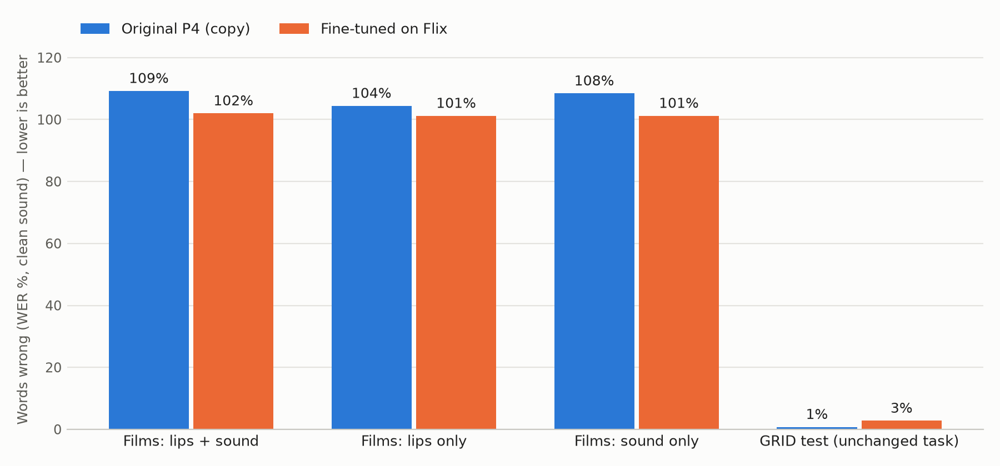

# Flix test: Model P4 on film and TV clips

Mouth clips mined from local films/series (`scripts/mine_flix.py`): one frontal face, lips moving, no camera cut, 0.8–3 s subtitle cue. Labels are the subtitle text, which is often paraphrased, so part of every error rate comes from the labels. Titles are split so no film appears in more than one of train/val/test.

## Data

- Clips kept: **305** (9.7 min) — train 244, val 18, test 43; dropped {}
- Test titles: challengers, little_women, the_drama
- Distinct words: 651 (GRID knows 51; 16 shared)
- Test words also seen in Flix training: 194 / 249
- Fine-tuning mix: 3030 rows (Flix train ×8 + a GRID subset so GRID is not forgotten)

## Results (greedy decoding, WER % / CER %)

| Test set | Model | clean | 0 dB |
|---|---|---:|---:|
| Films: lips + sound | Original P4 (copy) | 109.2 / 81.5 | 114.5 / 82.5 |
| Films: lips + sound | Fine-tuned on Flix | 102.0 / 77.9 | 101.2 / 79.2 |
| Films: lips only | Original P4 (copy) | 104.4 / 82.1 | 104.4 / 82.1 |
| Films: lips only | Fine-tuned on Flix | 101.2 / 83.5 | 101.2 / 83.5 |
| Films: sound only | Original P4 (copy) | 108.4 / 81.0 | 114.1 / 83.7 |
| Films: sound only | Fine-tuned on Flix | 101.2 / 80.4 | 100.4 / 81.8 |
| GRID test (unchanged task) | Original P4 (copy) | 0.8 / 0.3 | 2.6 / 1.1 |
| GRID test (unchanged task) | Fine-tuned on Flix | 2.8 / 1.0 | 6.2 / 2.5 |

*Lips only* = sound silenced at test time; *sound only* = video blanked. Comparing them shows which input the model relies on. The GRID row checks that fine-tuning did not break the original task.

## New words (not in GRID's vocabulary) written correctly on Flix test, clean sound

| Model | Lips + sound | Lips only | Distinct new words right (lips + sound) |
|---|---:|---:|---|
| Original P4 (copy) | 2 / 223 | 1 / 223 | it |
| Fine-tuned on Flix | 2 / 223 | 0 / 223 | the, you |

## Example transcripts (Flix test, clean sound)

| Subtitle | Original P4 | Fine-tuned |
|---|---|---|
| wait why didnt you just open it | bin whied it z tre soon | i  oe you ie |
| she was walking her baby in the middle of the night | bin green in m nire non | in  iy ot |
| before he was published | bive we t  agon | five  at |
| weird little british freak | lian white at j three non | ie aed   id |
| dont pussy out on us now | set rie at e nine now | shet the soe oire loe |
| we are just different | bin re ith  seaon | oo  moe |
| oh i thought you were a novelist not a screenwriter | lay reten bi v iro soon | e  bou soa die |
| hi dad okay really quick question | bin red ith r fe non | am t atthie |
| our daughter | plac whe at  now |  a he |
| well how can you even trust her | bay wree bt s e soon | n o do u eve nt |

Fine-tune run: `runs/flix_finetune_p4_20261112-065100` (best checkpoint copied to `checkpoints/flix_finetuned_p4.pt`). The main model `../cv_project_LipScribe/checkpoints/p_proposed_best.pt` was only read; see `main_model_md5.txt`.
