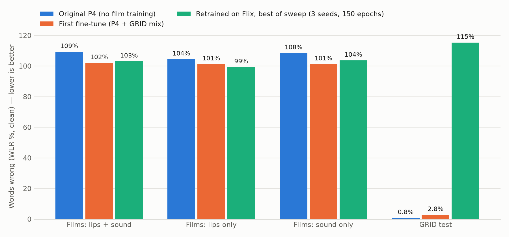

# Flix: Model P retrained on film clips, with a hyperparameter sweep

Data: 305 clips (9.7 min, 651 distinct words). Train 193 / val 69 / test 43 clips; titles never shared between splits (val: i_robot, skyfall, the_devil_all_the_time, vision_quest; test: challengers, little_women, the_drama).
Training uses Flix only (no GRID). Runs are chosen on validation CER (letters wrong), because WER stays near 100% on film speech. The test titles were scored once, at the end.

## Test results (clean sound; WER % / CER %)

| Model | Films: lips + sound | Films: lips only | Films: sound only | GRID test | Non-GRID words right |
|---|---:|---:|---:|---:|---:|
| Original P4 (no film training) | 109.2 / 81.5 | 104.4 / 82.1 | 108.4 / 81.0 | 0.8 / 0.3 | 2 of 223 |
| First fine-tune (P4 + GRID mix) | 102.0 / 77.9 | 101.2 / 83.5 | 101.2 / 80.4 | 2.8 / 1.0 | 2 of 223 |
| Retrained on Flix, best of sweep (3 seeds, 150 epochs) | 103.1 ± 3.8 / 74.5 ± 0.4 | 99.3 ± 0.6 / 90.5 ± 1.1 | 103.6 ± 3.4 / 75.0 ± 0.4 | 115.3 ± 7.7 / 77.8 ± 5.5 | 3 / 2 / 4 of 223 |

Distinct non-GRID words the retrained model wrote correctly (any seed): and, the, you

## Sweep (26 configurations, seed 1, sorted by val CER)

| Trial | init | lr | freeze | dropout | wd | audio drop | batch | noise | best epoch | val CER % | val WER % |
|---|---|---:|---|---:|---:|---:|---:|---|---:|---:|---:|
| t03 | p4_recipe | 0.001 | visual_encoder | 0.3 | 0.05 | 0.25 | 8 | mild | 63/80 | 74.4 | 109.7 |
| t05 | from_p4 | 0.001 | none | 0.5 | 0.05 | 0.25 | 8 | mild | 52/80 | 75.5 | 107.7 |
| t16 | from_p4 | 0.001 | visual_encoder | 0.3 | 0.01 | 0.5 | 8 | mild | 47/80 | 75.7 | 106.1 |
| t08 | p4_recipe | 0.001 | visual_encoder | 0.3 | 0.01 | 0.25 | 8 | mild | 54/80 | 75.9 | 109.9 |
| t15 | from_p4 | 0.001 | visual_encoder | 0.5 | 0.01 | 0.5 | 16 | mild | 70/80 | 76.3 | 107.3 |
| t07 | from_p4 | 0.001 | none | 0.3 | 0.01 | 0.5 | 8 | all | 79/80 | 78.0 | 103.1 |
| t22 | from_p4 | 0.0003 | none | 0.3 | 0.05 | 0.5 | 8 | mild | 0/41 | 79.8 | 104.9 |
| t10 | from_p4 | 0.0003 | none | 0.3 | 0.05 | 0.5 | 16 | all | 0/41 | 80.1 | 110.2 |
| t21 | from_p4 | 0.0001 | none | 0.3 | 0.01 | 0.25 | 16 | mild | 1/42 | 80.5 | 110.0 |
| t11 | from_p4 | 0.0001 | visual_encoder | 0.5 | 0.05 | 0.5 | 16 | mild | 2/43 | 80.8 | 111.7 |
| t09 | from_p4 | 0.0001 | none | 0.5 | 0.05 | 0.25 | 8 | all | 1/42 | 81.0 | 103.7 |
| t04 | from_p4 | 0.0003 | visual_encoder | 0.5 | 0.05 | 0.25 | 16 | all | 0/41 | 81.0 | 109.9 |
| t20 | p4_recipe | 0.0003 | none | 0.3 | 0.01 | 0.25 | 8 | mild | 79/80 | 81.1 | 99.4 |
| from_p4 | from_p4 | 0.0001 | none | 0.3 | 0.01 | 0.25 | 16 | all | 2/43 | 81.2 | 104.0 |
| t00 | from_p4 | 0.0001 | visual_encoder | 0.3 | 0.05 | 0.25 | 16 | all | 3/44 | 81.5 | 102.7 |
| t12 | from_p4 | 0.0001 | visual_encoder | 0.5 | 0.01 | 0.25 | 8 | mild | 1/42 | 81.6 | 104.2 |
| t18 | p4_recipe | 0.0003 | none | 0.5 | 0.01 | 0.25 | 8 | all | 79/80 | 84.3 | 99.9 |
| t02 | from_p4 | 0.001 | none | 0.5 | 0.05 | 0.25 | 16 | all | 0/41 | 89.1 | 100.6 |
| t19 | p4_recipe | 0.001 | visual_encoder | 0.3 | 0.01 | 0.5 | 8 | all | 77/80 | 90.4 | 99.4 |
| p4_recipe | p4_recipe | 0.0003 | none | 0.3 | 0.01 | 0.25 | 16 | all | 54/80 | 93.3 | 99.7 |
| t17 | p4_recipe | 0.0003 | visual_encoder | 0.3 | 0.01 | 0.25 | 16 | all | 75/80 | 93.4 | 99.9 |
| t06 | p4_recipe | 0.0001 | visual_encoder | 0.5 | 0.05 | 0.25 | 8 | all | 69/80 | 98.7 | 100.0 |
| t14 | p4_recipe | 0.0001 | none | 0.3 | 0.05 | 0.5 | 8 | all | 66/80 | 99.4 | 100.0 |
| t23 | p4_recipe | 0.0001 | visual_encoder | 0.5 | 0.01 | 0.5 | 16 | all | 0/41 | 99.4 | 100.0 |
| t13 | p4_recipe | 0.0001 | none | 0.3 | 0.05 | 0.5 | 16 | all | 0/41 | 99.5 | 100.0 |
| t01 | p4_recipe | 0.0001 | none | 0.5 | 0.05 | 0.25 | 16 | mild | 0/41 | 99.5 | 100.0 |

Best configuration **t03**: `{'init': 'p4_recipe', 'lr': 0.001, 'freeze': 'visual_encoder', 'dropout': 0.3, 'weight_decay': 0.05, 'audio_dropout': 0.25, 'batch_size': 8, 'snrs': 'mild'}`; final 150-epoch runs, val CER over seeds: 75.3%, 75.6%, 74.8%

Anchors: `p4_recipe` = the P4 recipe (B1 + B2-v2 encoders, new fusion and CTC head) on Flix; `from_p4` = start from the whole P4. `noise: mild` = training SNRs {clean, clean, 10, 5}.
