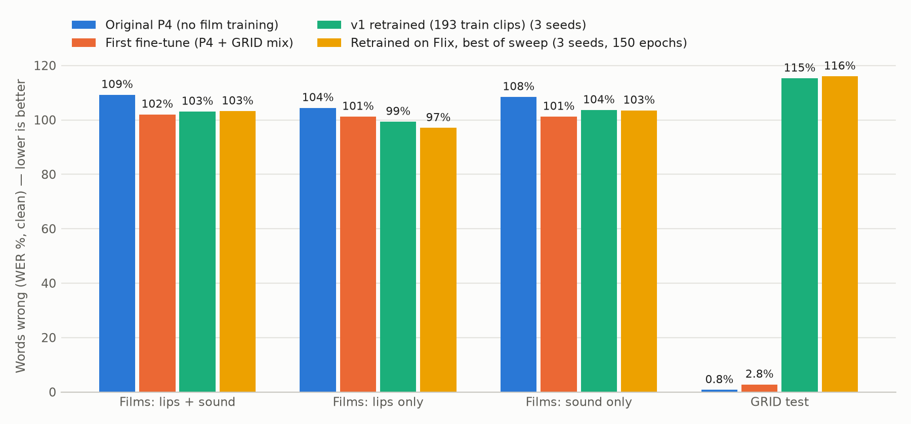

# Flix: Model P retrained on film clips, with a hyperparameter sweep

Data: 1268 clips (39.4 min, 1606 distinct words). Train 1156 / val 69 / test 43 clips; titles never shared between splits (val: i_robot, skyfall, the_devil_all_the_time, vision_quest; test: challengers, little_women, the_drama).
Training uses Flix only (no GRID). Runs are chosen on validation CER (letters wrong), because WER stays near 100% on film speech. The test titles were scored once, at the end.

## Test results (clean sound; WER % / CER %)

| Model | Films: lips + sound | Films: lips only | Films: sound only | GRID test | Non-GRID words right |
|---|---:|---:|---:|---:|---:|
| Original P4 (no film training) | 109.2 / 81.5 | 104.4 / 82.1 | 108.4 / 81.0 | 0.8 / 0.3 | 2 of 223 |
| First fine-tune (P4 + GRID mix) | 102.0 / 77.9 | 101.2 / 83.5 | 101.2 / 80.4 | 2.8 / 1.0 | 2 of 223 |
| v1 retrained (193 train clips) (3 seeds) | 103.1 ± 3.8 / 74.5 ± 0.4 | 99.3 ± 0.6 / 90.5 ± 1.1 | 103.6 ± 3.4 / 75.0 ± 0.4 | 115.3 ± 7.7 / 77.8 ± 5.5 | 3 / 2 / 4 of 223 |
| Retrained on Flix, best of sweep (3 seeds, 150 epochs) | 103.2 ± 1.8 / 72.5 ± 1.2 | 97.1 ± 0.6 / 87.6 ± 1.9 | 103.5 ± 1.8 / 72.4 ± 1.2 | 116.0 ± 4.9 / 72.0 ± 5.4 | 1 / 3 / 3 of 223 |

Distinct non-GRID words the retrained model wrote correctly (any seed): do, hi, the, to, you

## Sweep (0 configurations, seed 1, sorted by val CER)

| Trial | init | lr | freeze | dropout | wd | audio drop | batch | noise | best epoch | val CER % | val WER % |
|---|---|---:|---|---:|---:|---:|---:|---|---:|---:|---:|

Best configuration **t03**: `{'init': 'p4_recipe', 'lr': 0.001, 'freeze': 'visual_encoder', 'dropout': 0.3, 'weight_decay': 0.05, 'audio_dropout': 0.25, 'batch_size': 8, 'snrs': 'mild'}`; final 150-epoch runs, val CER over seeds: 73.3%, 73.8%, 73.7%

Anchors: `p4_recipe` = the P4 recipe (B1 + B2-v2 encoders, new fusion and CTC head) on Flix; `from_p4` = start from the whole P4. `noise: mild` = training SNRs {clean, clean, 10, 5}.
